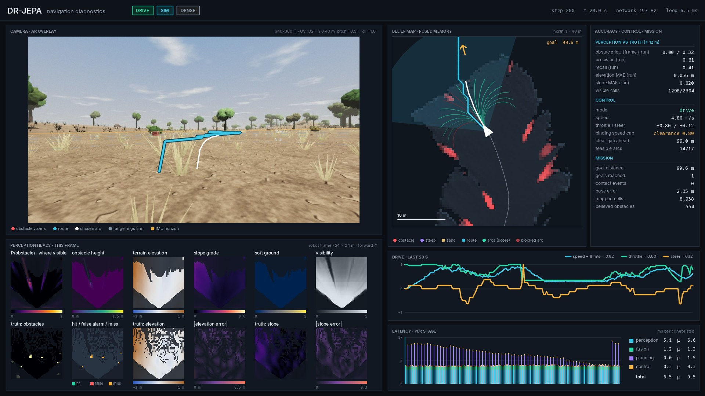
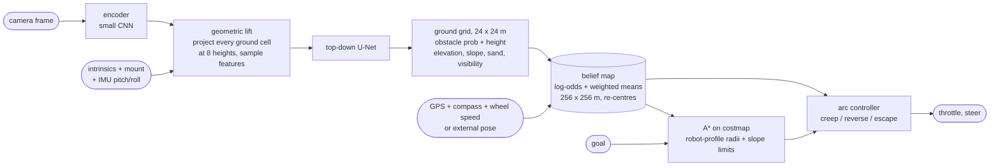

# DR-JEPA

**Camera-only navigation for any robot and any camera.** One forward camera,
an IMU and a pose source in; drive commands and a persistent metric map of
the world out. No lidar, no stereo, no prior map.



DR-JEPA turns each camera frame into a **metric top-down grid of physical
quantities** — where obstacles are and how tall, terrain elevation and
slope, soft ground, and what the camera can actually see — fuses those grids
into a **persistent belief map**, plans with **A\***, and tracks the route
with an **arc controller** that checks every candidate motion against the
map.

The perception network is camera-agnostic *by construction*: every ground
cell is projected through the real camera model (intrinsics + mount + IMU
attitude) and image features are sampled exactly where that cell appears.
Nothing about one particular lens or mast is memorized, so the same model
runs on a 0.3 m wide-angle bumper camera and a 2 m mast camera, rolled or
pitched. And because it predicts physical quantities, *your* robot's
profile (footprint, step height, slope limits) decides what is blocking.

| | |
|---|---|
| perception network | **4.5 M parameters**, one ONNX file with the camera as an input |
| latency (perception) | **~3 ms** RTX 4080 · **29 ms** CPU, 4 threads · 68 ms CPU, 1 thread |
| full control step | ~8 ms (perception + fusion + A\* + control) |
| closed loop, 144 unseen worlds, random camera rigs | **93.8 % success** (privileged expert 97.2 %) |

Results, methodology and the honest gaps are in
[docs/benchmarks.md](docs/benchmarks.md); why it is built this way (and what
was tried and measured worse) is in [docs/design.md](docs/design.md).

---

## How it works



1. **Perceive** — `drjepa/perception`. GeoBEV: EfficientNet-B0 features at
   stride 8; for each of the 48 x 48 ground cells (0.5 m) and 8 heights
   (-2 m ... +2 m) the 3D point is projected through the camera and the
   feature map is sampled there (the Simple-BEV view transform). The
   network gets the ray geometry it used (depth along the ray, image row),
   and a top-down U-Net predicts six channels per cell.
2. **Remember** — `drjepa/nav/mapping.py`. Prior-corrected log-odds
   occupancy with asymmetric positive evidence, decay and caps (each rule
   measured necessary), plus range-weighted means for elevation and slope.
   Visual-odometry scan matching nudges the pose filter.
3. **Plan** — `drjepa/nav/planning.py`. Weighted A* on a costmap from
   occupancy, distance-transform inflation, slope and sand, with a
   plan-consistency prior and deadlock-free fallbacks.
4. **Act** — `drjepa/nav/control.py`. 17 constant-curvature arcs scored on
   progress, clearance (fused map + zero-lag fresh-frame guard), alignment
   and smoothness; creep, map-checked reverse and escape behaviours; speed
   governed by clearance, curvature, goal distance and gap width.

---

## Put it on your robot

```python
import numpy as np
from drjepa import Camera, Navigator, RobotProfile

camera = Camera(width=1280, height=720, fx=522.6, fy=522.6, cx=634.7, cy=352.1,   # calibration
                mount_height=0.40,      # optical centre above the ground (m)
                mount_pitch=0.0,        # deg, + = looking up, relative to the chassis
                mount_roll=0.0)         # deg
robot = RobotProfile(radius=0.75, v_max=2.0, yaw_rate_max=70.0, step_height=0.25,
                     grade_drive=0.35, grade_block=0.55, tip_roll=0.50, tip_pitch=0.70)
nav = Navigator("geobev.onnx", camera=camera, robot=robot)   # .onnx -> no torch needed

while True:
    rgb = grab_frame()                                  # (H, W, 3) uint8 RGB
    cmd = nav.step(rgb, {
        "lat": gps.lat, "lon": gps.lon, "heading": compass_deg, "speed": wheel_mps,
        "pitch": imu.pitch_deg, "roll": imu.roll_deg,   # chassis attitude
        "goal_lat": goal.lat, "goal_lon": goal.lon,
    })
    drive(cmd.throttle, cmd.steer)                      # both in [-1, 1]
```

- **Camera.** Pinhole intrinsics of the (rectified) image you feed, plus the
  mount. Any resolution and aspect ratio; resize freely, the intrinsics are
  rescaled internally. Undistort fisheye images first.
- **Pose.** GPS + compass + wheel speed through the built-in complementary
  filter, or pass `"x"`, `"z"` (metres east/north), `"heading"` and
  `"goal_x"`, `"goal_z"` from your own estimator (VIO, EKF, ZED tracking).
- **Robot.** `RobotProfile` sets the footprint, dynamics, step height and
  slope limits (comfortable, climbable, side-slope and downhill tip limits,
  as rise / run) that turn perception into costs. `steer = +1` means turn
  right at `yaw_rate_max`; `throttle` is a fraction of top speed.
- **Rate.** The controller assumes 10 Hz (`NavConfig.dt`).

Export once, run anywhere ONNX Runtime runs (CPU, CUDA, TensorRT):

```bash
python -m drjepa export --checkpoint runs/geobev/best.pt --out geobev.onnx --verify
```

The `.json` manifest next to the `.onnx` documents the I/O contract, so a
C++ or Rust runtime needs no Python (see `drjepa/perception/export.py`).

---

## Quick start

```bash
python3.12 -m venv .venv && source .venv/bin/activate
pip install -e ".[sim,export,dev]"        # + ".[teacher]" for the depth teacher / DINOv3
pytest                                    # 23 tests, ~1 min

python demo.py --checkpoint runs/geobev/best.pt --camera zed            # endless drive + HUD video
python dashboard.py --checkpoint runs/geobev/best.pt --scenario camp    # diagnostics dashboard
python dashboard.py --checkpoint runs/geobev/best.pt \
    --replay "recordings/zed/ZED_2i_31237348_(1)"                       # replay a real recording
```

The dashboard shows the camera with predicted obstacles, route and arcs
projected back into the image; all six perception heads; ground truth with
hit / false-alarm / miss and error maps (exact in sim, stereo on real
recordings); the fused belief map with every candidate arc scored; live
accuracy, the binding speed cap, telemetry and per-stage latency.

---

## Training your own model

Everything runs through one CLI, `python -m drjepa <command>`:

```bash
# 1. simulator data: GPU-rendered worlds, a random camera rig per episode
python -m drjepa gen --out data/sim --episodes 2000 --workers 24 --stride 3 --augment

# 2. real data (optional, strongly recommended): ZED 2i SVO recordings
./tools/zed/run.sh --svo recordings/svo/*.svo2 --output recordings/zed --hz 1   # SDK in Docker
python -m drjepa label-zed "recordings/zed/*"     # levelled poses + stereo grid labels

# 3. train (sim + real mixed; real-share 15 %)
python -m drjepa train --sim data/sim --encoder efficientnet_b0 --depth_aux \
    --real "recordings/zed/ZED_2i_31237348@0:0.85" "recordings/zed/ZED_2i_39163798@0:0.85" \
    --val_real "recordings/zed/ZED_2i_31237348@0.85:1" "recordings/zed/ZED_2i_39163798@0.85:1" \
    --out runs/geobev

# 4. evaluate + export
./tools/run_benchmarks.sh runs/geobev/best.pt bench/geobev
```

**The simulator** (`drjepa/sim`) renders on the GPU through headless EGL
(~2.5 ms/frame): shadow-mapped sun including the robot's own shadow,
procedural dirt / gravel / grass / sand materials, clouds and distant mesas,
lumpy rocks, foliage, grass tufts, and URC-camp objects (people, vehicles,
tents, sheds, cones, posts). Terrain has mounds, carved washes and sand;
physics has acceleration limits, steering lag, actuation latency, wheel
slip, contact sliding, stalls and terminal tip-over; sensors have GPS and
compass bias/noise. Every episode draws its own camera (resolution 1:1 to
16:9, HFOV 50-125 deg, height 0.3-2.2 m, pitch -28 to +6 deg, roll +-6 deg)
and labels come from exact geometry plus depth-buffer visibility.

**Real recordings** are exported from SVO to plain files (RGB, 16-bit
depth, confidence, gravity-aligned pose) by a Dockerized ZED SDK, then
labelled by the same depth -> grid geometry the simulator uses, after
re-levelling each frame on a RANSAC ground plane (the ZED's VIO gravity was
off by up to 30 deg on long recordings).

---

## Limitations and next steps

Measured, not hypothetical (details in [docs/benchmarks.md](docs/benchmarks.md)):

- **Real terrain needs more real data.** Both labelled real recordings are
  flat dirt lots. On the held-out Hanksville site the trained models detect
  obstacles better than a large depth model, but read gently rising ground as
  flat. The frozen-DINOv3 model and the distilled small model cut that error
  roughly in half; more varied real terrain (any ZED 2i drive through
  `tools/zed` + `label-zed`) is the direct fix.
- **Slopes are the main sim failure.** Every simulated tip-over happened on
  ground the map had observed, believed gentler than it was. The slope loss
  (`--grade_q 0.7 --grade_steep_w 4`) more than doubles steep-ground recall at
  the planner's lethal threshold.
- **Pose quality bounds contacts.** With perfect perception the stack still
  grazes ~3x more often than the privileged expert, because a GPS-filtered pose
  wanders ~1-1.7 m and smears the map. Feed VIO / EKF pose (`"x"`, `"z"`) when
  you have it.
- **The world is assumed static.** Moving people leave fading trails in the
  map (log-odds decay, ~46 s half-life).
- **Low cameras see far ground at grazing angles.** At 0.4 m, everything
  10-20 m away lies within a few pixels of the horizon; the map fills in as
  the robot approaches, but range beyond ~12 m is not trusted for fusion.
- **Attitude is required.** Feed chassis pitch / roll from any IMU (the ZED 2i
  has one). Without it, every slope the robot stands on tilts the whole grid.

---

## Repository layout

```
drjepa/
  camera.py          pinhole + mount camera model (shared by sim, labels, robot)
  config.py          RobotProfile, GridConfig, SimConfig
  labels.py          robot-frame grid targets from sim geometry or any depth map
  perception/        GeoBEV model, dataset, trainer, ONNX export + runtime, depth teacher
  nav/               belief map, A* planner, arc controller, Navigator API
  sim/               GPU renderer, worlds, rover physics, expert, data generation
  data/recordings.py real ZED recordings -> labelled episodes
  eval/              open-loop perception and closed-loop driving benchmarks
  viz/               dashboard + HUD (fonts vendored)
tools/zed/           ZED SDK container + SVO exporter
tools/run_benchmarks.sh
demo.py              endless closed-loop demo video
dashboard.py         diagnostics dashboard (sim or real replay)
docs/                benchmarks.md, design.md
tests/
```

## License

GPL-3.0 (see `LICENSE`). Bundled fonts: Inter (SIL OFL 1.1), Hack (MIT).
